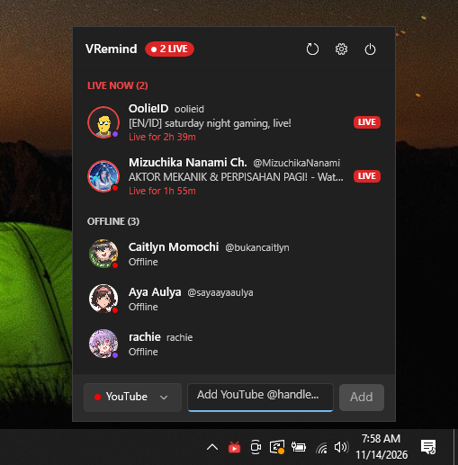

# VRemind for Windows (`VRemind-win`)

<p align="center">
  
</p>

<p align="center">
  <a href="https://microsoft.com/windows"></a>
  <a href="https://learn.microsoft.com/windows/apps/winui/winui3/"></a>
  <a href="https://github.com/momochisoundpost/VRemindCore"></a>
  <a href="LICENSE"></a>
  <a href="#running-tests"></a>
</p>

VRemind is a native Windows 10 (1809 LTSC and newer) and Windows 11 system tray VTuber stream reminder built with WinUI 3, using [`VRemindCore`](https://github.com/momochisoundpost/VRemindCore) in Swift as a drop-in Lego-piece engine.

> [!TIP]
> Looking for the Mac version? [VRemind for macOS (`VRemind`)](https://github.com/momochisoundpost/VRemind) is the original native macOS 12.0+ (Monterey and newer) menu bar app with WidgetKit desktop widgets, coded 100% in Swift (SwiftUI and AppKit) with zero third-party dependencies.

> [!NOTE]
> `VRemind-win` is entering maintenance mode. Now that [`VRemindCore`](https://github.com/momochisoundpost/VRemindCore) is cleanly separated and the Windows build is solid (even pulling ahead of the original Mac build with drag-to-reorder watchlists and 100% Win32-free UWP window chrome), future updates will focus on syncing `VRemindCore` and fixing upstream breakage (mostly because YouTube keeps changing things to keep their product managers employed). No new features are planned unless someone contributes one via PR or manages to scrape Kick.com without API keys.

> [!NOTE]
> After building [`VRemind`](https://github.com/momochisoundpost/VRemind) in Cupertino's walled garden (where a hobby menu bar utility gets treated like contraband unless you pay a $99/year landlord fee), VRemind left California for rainy Seattle. It skips Microsoft Store lock-in and MSIX certificate headaches, and treats Windows 10 LTSC boxes that refuse to die as first-class targets.

## Vibecoded with love (Seattle edition)

> *"Why did I vibecode this? Because I graduated from film school doing sound. What do you expect from someone who did film sound to write world-changing code from scratch? That's dumb."*

This project was vibecoded with Google Antigravity and [Superpowers](https://github.com/obra/superpowers) on a Windows 10 IoT Enterprise LTSC 2021 devbox (including through a real-life Wi-Fi outage on mobile data). It takes the Swift [`VRemindCore`](https://github.com/momochisoundpost/VRemindCore) engine from the Mac app and snaps it into a native WinUI 3 system tray frontend. Because `VRemindCore` runs unchanged as a drop-in companion engine, every upstream YouTube or Twitch scraping fix works in both the Mac menu bar app and the Windows tray app like a Lego piece.

<p align="center">
  
</p>

VRemind runs in your Windows system tray (notification area) and watches your favorite VTubers and content creators on YouTube and Twitch. When someone goes live or schedules an upcoming waiting room, it sends a native Windows toast notification that lets you jump straight into the stream in one click.

## Features

### Watchlist and `VRemindCore` engine

- Runs on [`VRemindCore`](https://github.com/momochisoundpost/VRemindCore) compiled natively for Windows (`vremind-core.exe`).
- Add any VTuber or creator by YouTube `@handle` (for example `@bukancaitlyn`, `@filian`, `@ironmouse`), by Twitch username (`ironmouse`), or by pasting a full `youtube.com` / `twitch.tv` URL for automatic platform detection.
- Click and drag any channel row up or down within its section (`LIVE NOW`, `UPCOMING`, or `OFFLINE`) to put your favorites in the exact order you want.
- A platform dropdown on the left of the input bar pairs with color-coded badges (red for YouTube, purple for Twitch) to keep creators on each platform distinct.
- Starts with Caitlyn Momochi ([@bukancaitlyn](https://www.youtube.com/@bukancaitlyn)) on YouTube as the default starter channel, which you can edit or remove.

### Live and upcoming stream detection

- Needs no API keys or developer accounts: `YouTubeStreamProvider` parses public YouTube `/live` HTML and `TwitchStreamProvider` queries Twitch's public web GraphQL endpoint to get stream titles, IDs, start times, and channel avatars.
- Tracks three channel states:
  - `🔴 LIVE`: Active broadcasts with the title, elapsed uptime, and direct watch link.
  - `🗓️ UPCOMING`: Scheduled waiting rooms with start times (for example, `in 45m`).
  - `Offline`: Time elapsed since the channel last streamed.
- Caps network checks at 3 concurrent requests to avoid rate limiting. Background polling pauses when Windows enters sleep or the session locks, and resumes immediately on wake or unlock.
- Shows an antenna icon in the system tray when all channels are offline, and switches to a steady red icon (`VRemind (Live now)`) when any watched channel goes live.

### DirectX 10 hardware-accelerated celebration mode

- Detects birthday, debut, and anniversary streams across English, Indonesian, and Japanese stream titles, plus a December 31 birthday celebration for `@bukancaitlyn`.
- Renders vsync-locked confetti rain via `CompositionTarget.Rendering` and GPU-backed `CompositeTransform` on the DirectX 10 (`D3D_FEATURE_LEVEL_10_0`) DirectComposition layer, with zero CPU layout passes per frame and zero idle CPU or GPU usage when the flyout is closed.
- Animates calm 2-color shifting-hue rainbow gradients (`6.0s` normal cycle, `36.0s` with Reduce Motion) across celebrating badges, avatar rings, time labels, and section headers, and disables confetti rain when Reduce Motion is enabled.

### Win32-free UWP window chrome, taskbar flyout (`360×440` DIP), and onboarding

- Left-clicking the tray icon toggles a borderless, DPI-aware `360×440` WinUI 3 flyout anchored above the Windows taskbar; it dismisses automatically when it loses focus.
- Every window in the app (`PopoverWindow`, `SettingsWindow`, `OnboardingWindow`, and `UpdateAvailableWindow`) uses 100% Win32-free UWP chrome with a matching dark or light title bar, a single `✕` close button, `1px` borders on Windows 10 (including Aero Lite), and native DWM rounded corners on Windows 11, with no legacy Win32 title bars or grayed-out Minimize/Maximize buttons.
- Right-clicking the tray icon opens a native context menu (`Open VRemind`, `Refresh Now`, `Settings...`, `Quit VRemind`).
- A first-run onboarding wizard (`OnboardingWindow`) lets you pick your first creator, verify Windows toast notifications, and configure software update checks.

### Native Windows toast notifications (1809 LTSC compatible)

- Uses the classic WinRT `ToastNotificationManager` and COM `INotificationActivationCallback` pipeline so unpackaged toast notifications work back to Windows 10 version 1809 (LTSC 2019) without the Microsoft Store.
- Includes separate toggles for live broadcasts (`🔴 LIVE`), scheduled waiting rooms (`⏳ UPCOMING`), and notification sounds (`Play notification sound`).
- Deduplicates alerts by video ID so you do not get notified twice for the same stream.
- Clicking a toast launches the stream in your default browser and routes through single-instance handling so you never get duplicate tray icons.

### Settings, portable JSON backups, and native release notes

- The General tab handles launch at Windows login (`HKCU\...\Run`), the Reduce Motion toggle, GitHub software update checks (with the `"Did you steal Caitlyn's computer?"` Easter egg), portable JSON backup and restore (`vremind-backup-YYYY-MM-DD.json`, interchangeable between macOS and Windows), and a Factory Reset danger zone.
- The Notifications tab has per-type alert toggles, a Send Test Notification button, and a direct link to Windows Notification Settings (`ms-settings:notifications`).
- The About tab shows version info, attribution and open-source fork copy, and social links (`YouTube`, `Twitter/X`, `GitHub`, `Instagram`).
- `UpdateAvailableWindow` renders GitHub Flavored Markdown (headings, blockquotes, checklists, GFM tables, code blocks, images) and inline looping `<video>` / `.mp4` release notes using 100% native WinUI 3 XAML and `MediaPlayerElement`, with no WebView2 dependency.

## Installation

### Option 1: Download a pre-built release (unpackaged portable / installer)

1. Download `VRemindWin-x64.zip` from the Releases page (or `VRemindWin-arm64.zip` for Windows 11 on ARM64).
2. Extract the folder anywhere you like and run `VRemindWin.exe`.

> [!TIP]
> Running Windows 11 on ARM64 (Snapdragon X, NVIDIA RTX Spark, or an Apple Silicon VM)? We are looking for volunteers with Windows 11 ARM64 hardware or VMs to help test native `win-arm64` builds. See the [Windows 11 on ARM64 Volunteer Testing & Build Guide](docs/WINDOWS-ARM64.md) to grab the pre-built CI artifact or build natively from source. ARM64 builds require Windows 11; Windows 10 on ARM is not supported.

> [!NOTE]
> Just like we refused to pay John Apple $99/year in California, we aren't paying a certificate cartel $300/year in Seattle to sign a free open-source VTuber reminder. If Windows Defender SmartScreen says *"Windows protected your PC"*, click More info, then Run anyway.

### Option 2: Build from source

Requirements: Windows 10 21H2+ (or 1809+) x64 with the .NET 9 SDK, Visual Studio 2022 C++ Build Tools + Windows 10 SDK, and Swift for Windows.

```powershell
# 1. Check installed prerequisites offline (0 MB network usage — safe for mobile data!)
powershell -ExecutionPolicy Bypass -File .\scripts\check-toolchain.ps1

# 2. Install any missing SDKs/toolchains (requires -ConfirmDownload when on Wi-Fi)
powershell -ExecutionPolicy Bypass -File .\scripts\install-toolchain.ps1 -ConfirmDownload

# 3. Build the Swift VRemindCore CLI + Self-Contained Unpackaged WinUI 3 App
powershell -ExecutionPolicy Bypass -File .\scripts\build-app.ps1

# 4. Launch VRemind for Windows
.\dist\VRemindWin\VRemindWin.exe
```

## Quick start and usage

1. Look for the VRemind antenna icon in your Windows system tray (click the `^` overflow chevron and drag it onto the taskbar if Windows hides new icons). If any watched channel goes live, the icon turns solid red.
2. To add a creator, left-click the tray icon to open the flyout popover, pick YouTube or Twitch from the left dropdown, enter a handle or username (for example `@bukancaitlyn` or `ironmouse`) or paste a channel URL, and press Enter or click Add.
3. Click any channel row or Windows toast notification to open the stream in your default browser.
4. Click and drag any channel row up or down within `LIVE NOW`, `UPCOMING`, or `OFFLINE` to put your favorites at the top.
5. To remove a channel, hover over its row and click the trash can icon.
6. Click the gear icon (`⚙`) in the popover header, or right-click the tray icon and select "Settings...", to configure notifications and launch-at-login behavior.
7. To quit, click the power icon (`⏻`) in the popover header, or right-click the tray icon and select "Quit VRemind".

## Frequently asked questions

### Is there a macOS or Linux build?

- macOS: Yes. [`VRemind`](https://github.com/momochisoundpost/VRemind) is the original native macOS 12.0+ (Monterey and newer) Universal (`arm64` + `x86_64`) menu bar app, built 100% in Swift with SwiftUI, AppKit, and native WidgetKit desktop widgets (`Small Hero`, `Medium Watchlist`, `Large Dashboard`), with zero third-party dependencies. Your JSON backups (`vremind-backup-YYYY-MM-DD.json`) are 100% interchangeable between macOS and Windows.
- Linux: Not officially yet, though `VRemindCore` is ready for it. Starting with 1.3 ("Better Together"), the platform-agnostic engine ([`VRemindCore`](https://github.com/momochisoundpost/VRemindCore)) lives in its own Swift package repository using only `Foundation` and `FoundationNetworking`, so it runs anywhere Swift runs and gives you a starting point for KDE Plasma, GNOME, or other Linux tray ports. Check [`momochisoundpost/VRemindCore`](https://github.com/momochisoundpost/VRemindCore) if you want to build on top of it.

### Why are you supporting Windows 10 1809 (LTSC 2019) and 21H2 (IoT LTSC 2021)?

On the Mac side I refused to drop macOS 12 Monterey for OCLP and glowing-Apple-logo MacBook users, and on the Seattle side I will never drop support for something Microsoft still supports. Windows 10 Enterprise LTSC 2019 (1809, build `17763`) is supported until 2029, and Windows 10 IoT Enterprise LTSC 2021 (21H2, build `19044`) is supported until 2032. Because LTSC machines strip out the Microsoft Store and consumer bloatware by design, `VRemind-win` is built from day one as an unpackaged WinUI 3 app with an 1809-compatible COM toast pipeline that needs zero Store infrastructure.

### Why was this made using WinUI 3?

WinUI 3 is the Windows equivalent of SwiftUI: a declarative native UI framework without Electron or WebView bloat. Just as the Mac app uses SwiftUI and AppKit for a native menu bar app, `VRemind-win` uses WinUI 3 and Win32 tray interop on Windows 10 (1809+) and Windows 11.

### Why use Swift `VRemindCore` inside a Windows WinUI 3 app?

Maintaining two separate YouTube HTML scrapers and Twitch GraphQL parsers in two different languages means fixing every upstream change twice. Keeping [`VRemindCore`](https://github.com/momochisoundpost/VRemindCore) in pure cross-platform Swift (`Foundation` + `FoundationNetworking`) and compiling it into a headless companion binary (`vremind-core.exe`) lets every backend update drop into both `VRemind` (macOS) and `VRemind-win` (Windows) like a Lego piece.

### Why is the file size so much bigger than the Mac app?

Because I suck at Windows development (Swift on Mac is my mother tongue), and I wanted to be 100% sure you do not have to install any external redistributables just to launch the app.

On macOS, everything VRemind uses (`Swift`, `SwiftUI`, `AppKit`, `Foundation`, `AVKit`, `UserNotifications`) is already built into the operating system; the app binary is mostly just telling the OS what to do, so the Mac app stays tiny. On Windows (especially unpackaged Windows 10 1809 LTSC), `.NET 9`, `Windows App SDK / WinUI 3`, and the `Swift for Windows` runtime are not built into the OS. So you do not have to hunt down three separate runtime installers, the release zip ships everything in one self-contained folder where you can just unzip and run `VRemindWin.exe`. I'll optimize and trim the size down sooner or later.

### Do I need a YouTube or Twitch API key?

No. VRemind needs zero API keys, no Google Cloud developer projects, and no Twitch OAuth credentials. It checks YouTube directly through publicly accessible `/live` pages and checks Twitch through public unauthenticated web queries.

### Does this hog RAM or CPU in the background?

Not at all.

- Network polling runs once every 3 minutes via `vremind-core.exe`, throttled to a maximum of 3 concurrent requests.
- When Windows enters sleep or you lock your screen, polling pauses automatically and resumes when you return.
- Watchlist and settings state lives in human-readable JSON files under `%APPDATA%\VRemind\`.

### Can I track creators who aren't VTubers?

Yes. VRemind was designed with VTubers in mind, but you can monitor any YouTube or Twitch channel that livestreams by entering their handle or username (for example tech creators, podcasters, esports channels, or gamers).

### Can I remove Caitlyn Momochi from my watchlist?

Yes. Caitlyn Momochi is only the default starter channel so the list isn't blank on first launch. Hover over the channel row, click the trash can icon, and add whoever you like.

### What if YouTube or Twitch changes its page or endpoint format?

`VRemind-win` uses the `LivePageParser` and `TwitchResponseParser` parsers behind `StreamProvider` in [`VRemindCore`](https://github.com/momochisoundpost/VRemindCore), so upstream platform changes can be fixed in the shared Swift engine without touching Windows UI code. If a creator goes live and VRemind doesn't pick it up, open an issue or pull request. Automated unit tests cover the Windows app (`94` in `VRemindWin.Tests`), companion CLI (`11` in `VRemindCoreCLITests`), and core engine (`69` in `VRemindCoreTests`).

## Architecture overview

`VRemind-win` pairs an unpackaged C# `.NET 9` WinUI 3 system tray host (`VRemindWin`) with the cross-platform Swift [`VRemindCore`](https://github.com/momochisoundpost/VRemindCore) engine compiled as a headless companion CLI (`VRemindCoreCLI` / `vremind-core.exe`):

```text
VRemind-win/
├── VRemindCore/                  # Shared pure-Foundation Swift engine
├── VRemindCoreCLI/               # Headless Swift companion CLI (vremind-core.exe)
│   ├── Package.swift             # Links directly against ../VRemindCore
│   ├── Sources/VRemindCoreCLI/   # CLI entrypoint
│   ├── Sources/VRemindCoreCLIKit/# JSON commands: state, refresh, add, remove, settings, backup, onboarding, check-update
│   └── Tests/VRemindCoreCLITests/
├── VRemindWin/                   # Native C# .NET 9 Unpackaged WinUI 3 Tray Application
│   ├── VRemindWin.sln
│   ├── src/VRemindWin.Core/      # Coordinators, view models, Markdown parser, gradient math, toast XML & Win32 helpers
│   ├── src/VRemindWin/
│   │   ├── Program.cs            # Single-instance mutex & 1809 AUMID/COM bootstrap
│   │   ├── Services/             # TrayIconService, NativeFileDialogService
│   │   └── Views/                # PopoverWindow, PopoverView, SettingsWindow, OnboardingWindow, UpdateAvailableWindow & Controls/
│   └── tests/VRemindWin.Tests/   # xUnit test suite
├── docs/
│   └── superpowers/              # Design specs and implementation plans
└── scripts/
    ├── check-toolchain.ps1       # Zero-network prerequisite & download-size checker
    ├── install-toolchain.ps1     # Data-gated (-ConfirmDownload) SDK & toolchain installer
    ├── generate-icons.ps1        # Multi-size .ico generator (app-icon, tray-normal, tray-live)
    ├── build-cli.ps1             # Builds vremind-core.exe + stages Swift Windows runtime DLLs
    └── build-app.ps1             # Packages self-contained dist/VRemindWin/ bundle
```

## Requirements

- Runtime OS (`x64`): Windows 10 version 1809 (build `17763`, Enterprise LTSC 2019) or newer, and Windows 11 (`x64`).
- Runtime OS (`ARM64`): Windows 11 on ARM64 (Snapdragon X, NVIDIA RTX Spark, or an Apple Silicon VM). Windows 10 on ARM is not supported. See [docs/WINDOWS-ARM64.md](docs/WINDOWS-ARM64.md).
- Building from source: Windows 10 21H2 (build `19044`, IoT Enterprise LTSC 2021) or newer (`x64`), or Windows 11 (`ARM64`), with `.NET 9 SDK`, `Visual Studio 2022 C++ Build Tools + Windows 10/11 SDK`, and `Swift for Windows 6.0.3`.

> [!NOTE]
> Windows 11 Desktop Widget Provider support is planned as a separate milestone. The core system tray app, notifications, celebration mode, onboarding, backup/restore, and updater already have 100% parity with macOS `VRemind` v1.3.1.

## Running tests

Run the Swift companion CLI tests (from a Visual Studio x64 Native Tools Command Prompt), C# xUnit suite, and toolchain script checks:

```powershell
# Swift VRemindCoreCLI tests (run from VS 2022 x64 Native Tools Command Prompt on Windows)
swift test --package-path VRemindCoreCLI -Xcc -D__MM_MALLOC_H

# C# WinUI 3 coordinator, view model, Markdown parser, gradient, toast XML, and flyout positioning tests
dotnet test VRemindWin\tests\VRemindWin.Tests\VRemindWin.Tests.csproj

# Offline toolchain verification scripts
powershell -NoProfile -ExecutionPolicy Bypass -File .\scripts\tests\verify-toolchain-scripts.ps1
```

## Disclaimer

VRemind is an independent open-source project and is not affiliated with, endorsed by, or associated with YouTube, Google LLC, Twitch Interactive, Inc., Apple Inc., or Microsoft Corporation.

VRemind checks streams using publicly accessible YouTube `/live` pages and public unauthenticated Twitch web queries without an API key. Upstream platforms may change their markup or payloads from time to time. If stream statuses or avatars fail to parse after a platform update, open an issue or pull request.

## Contributing

Contributions, bug reports, and suggestions are welcome.

1. Fork the repository.
2. Create a feature branch (`git checkout -b feat/my-new-feature`).
3. Make sure the unit test suites pass (`dotnet test` and `swift test`).
4. Commit your changes and open a pull request.

## License

This project is licensed under the MIT License. See the [LICENSE](LICENSE) file for details.

*"You don't like what I did? Go fork yourself, it's free and open source."*
